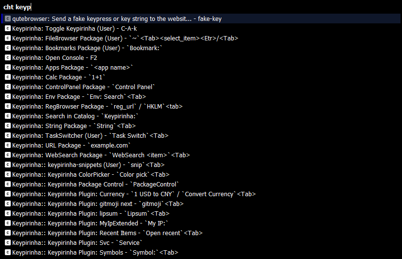

  

# keypirinha-cheatsheet-txt

> This repository is archived and kept for historical reference only.
> I'm currently using [fzf-txt.sh](https://github.com/scillidan/scripts/blob/main/fzf-txt.sh) instead.

Search keyboard shortcuts from plain text files. Compatible with [rofi-shortcuts.conf](https://github.com/Zeioth/rofi-shortcuts/blob/master/rofi-shortcuts.conf) format (see `data/example.cht`).

Authors: GLM-5.1🧙‍♂️, scillidan🤡

The icon is from [Input Prompts](https://www.kenney.nl/assets/input-prompts) by [Kenney](https://www.kenney.nl).

## Features

- Fuzzy search via `cht <query>` (AND logic, preserves file order)
- Copies shortcut to clipboard on execute, with optional notification
- Supports both `#` and `##` comment prefixes
- `\|` escape for literal pipe in shortcuts
- Multi-directory recursive scan with include/exclude globs
- Standalone `files` config for files outside scan directories

See `cheatsheettxt.ini` for full usage details.
